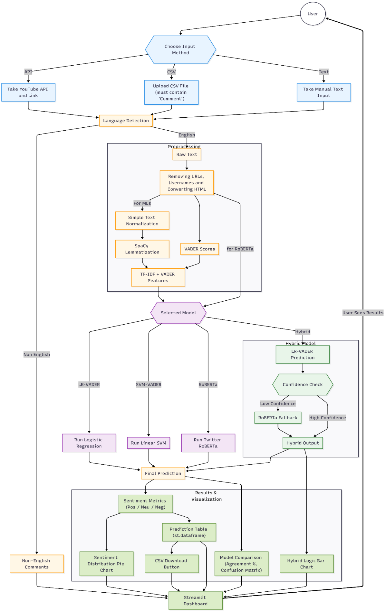
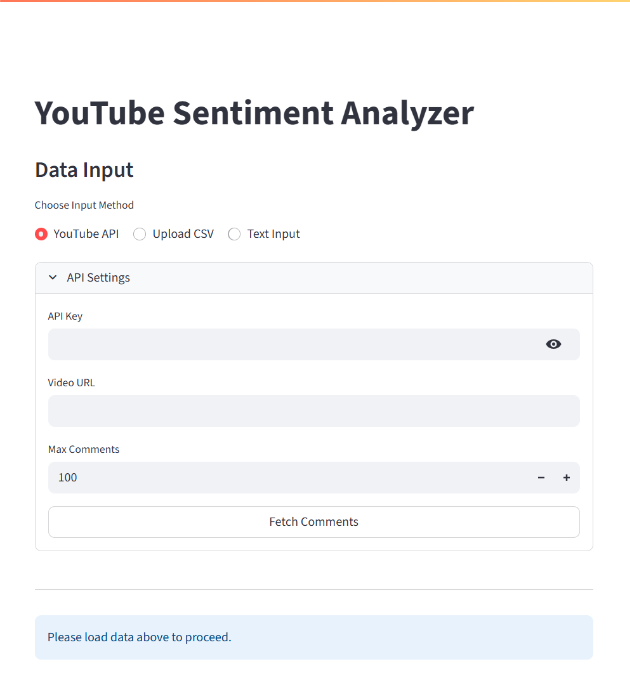
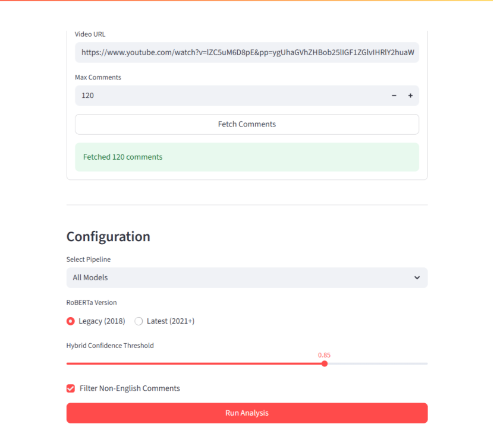
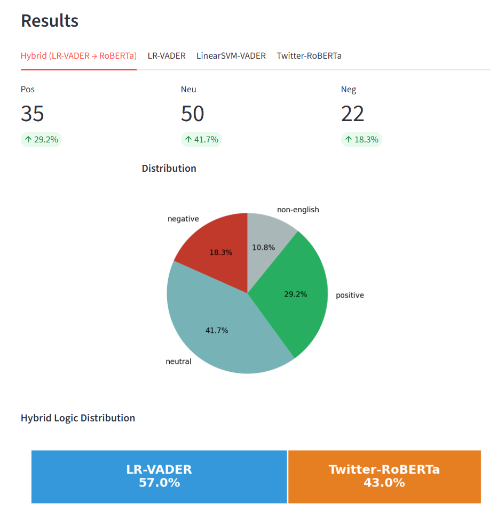
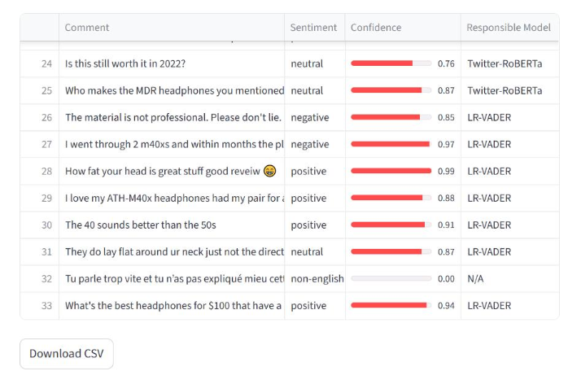

# 📊 YouTube Comment Sentiment Analysis

A fully interactive web application built with **Streamlit** for downloading YouTube comments and analyzing their sentiment using several NLP models, including:

* **Twitter RoBERTa (HuggingFace)**
* **Hybrid model (LR-VADER → falls back to RoBERTa when uncertain)**
* **Logistic Regression + VADER features model**
* **Linear SVM + VADER features model**
* **Custom models saved with joblib**

---

## App Capabilities

✓ Automatic extraction of YouTube comments
✓ CSV file upload
✓ Comparison of multiple NLP models
✓ Language detection and filtering
✓ Confidence-based hybrid model
✓ Confusion matrix display
✓ Downloadable results

---

## 🚀 Features

### 🔹 1. Fetching YouTube Comments

By entering a video link and an API key, you can fetch up to **5,000 comments** through the YouTube Data API.

---

### 🔹 2. CSV Upload

You can upload a `.csv` file containing a `Comment` column to run the analysis offline.

---

### 🔹 3. Multiple NLP Models

You can run sentiment analysis with the following models:

| Model                 | Description                                                                  |
| --------------------- | ---------------------------------------------------------------------------- |
| **Twitter-RoBERTa**   | Transformer model from HuggingFace (highest accuracy)                        |
| **Hybrid Model**      | Combines LR + VADER, and uses RoBERTa when the confidence is low             |
| **LR-VADER Models**   | Logistic regression with VADER features                                      |
| **Linear SVM Models** | SVM model with VADER features                                                |
| **All Models**        | Runs all models and compares them                                            |

---

### 🔹 4. Language Detection

Using the `langdetect` library, non-English comments are identified and labeled.

---

### 🔹 5. Preprocessing Pipeline

Includes the following steps:

* Removing and normalizing URLs and mentions
* Converting emojis to text (emoji demojization)
* Lemmatization
* Extracting VADER features
* Cleaning with regex
* Using the HuggingFace tokenizer

---

### 🔹 6. Downloadable Output

Each model tab includes:

* Sentiment pie chart
* Display of the model's decision in hybrid mode
* Confusion matrix
* Button to download a `.csv` file

---

## How the System Works



---

## 📂 Project Structure

```text
project/
│
├── app.py                  # Main Streamlit application
├── final_lr_sentiment_model.joblib
├── more_data_lr_model.joblib
├── final_linear_svm_model.joblib
├── linear_svm_model.joblib
└── roberta-local/          # (Optional) RoBERTa model downloaded locally
```

---

## 🔧 Project Setup

### 1. Install dependencies

```bash
pip install -r requirements.txt
```

---

### 2. Run the application

```bash
streamlit run app.py
```

---

## 🔑 Setting Up the YouTube API

To use API mode:

1. Create an API key in Google Cloud Console
2. Enable **YouTube Data API v3**
3. Enter the API key in the user interface

---

## 🧠 How the Hybrid Model Works

1. Run Logistic Regression + VADER
2. If the confidence is low, send the text to RoBERTa
3. Combine the results
4. The output includes:

   * Sentiment
   * Confidence level
   * Which model made the decision

This approach improves accuracy and reduces the cost of using RoBERTa.

---

## 📈 Model Comparison

When multiple models are run, the system automatically:

* Compares each model against RoBERTa
* Calculates the agreement score
* Generates the confusion matrix for English comments

---

## 🛡 Error Handling and User Experience

* Fallback when HuggingFace, a GPU, or langdetect is unavailable
* Spinners and progress bars in Streamlit
* Clear warnings shown to the user
* Robust error logging

---

## Output Screenshots

---

---

---

---
